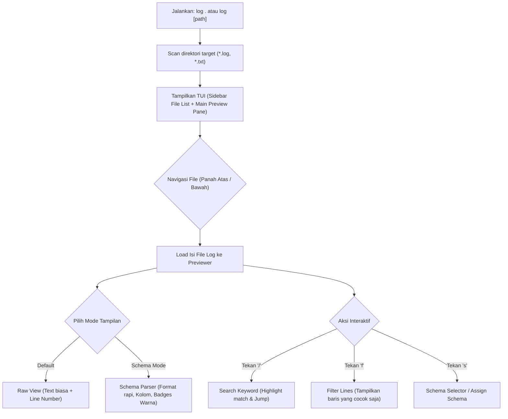

# Product Requirements Document (PRD): Log-Cell (CLI Log Reader & Formatter)

## 1. Executive Summary & Problem Statement

### 1.1 Latar Belakang & Masalah
Saat melakukan debugging, monitoring aplikasi, atau menganalisis server, developer sering berhadapan dengan file log yang panjang, berantakan, dan sulit dibaca. Menggunakan tool bawaan terminal seperti `cat`, `tail`, atau `less` memiliki keterbatasan:
- Tidak memiliki navigasi interaktif antar file log dalam satu direktori.
- Tampilan log mentah (*raw*) sering kali monoton, tidak ada pewarnaan dinamis berdasarkan level log (*INFO, WARN, ERROR*), dan sulit membedakan timestamp dengan isi pesan.
- Format log antar-service berbeda-beda (misal: log aplikasi A menggunakan format custom, aplikasi B menggunakan JSON/Syslog), sehingga developer pusing memindai struktur datanya.
- Pencarian dan filter cepat (*filtering data/kata kunci*) di terminal memerlukan perintah pipa bash yang panjang (`grep`, `awk`, dll.).

### 1.2 Solusi
**Log-Cell** adalah aplikasi CLI interaktif (Terminal User Interface / TUI) berbasis **Bun + Ink (React in Terminal)** yang memungkinkan developer membaca, menavigasi, dan memformat file log secara mudah dan rapi hanya dengan satu perintah: `log .` atau `log <path>`.

Tool ini memiliki kemampuan utama:
1. **Auto-Discovery & File Picker:** Otomatis memindai dan me-listing file `.txt` dan `.log` di folder target dengan navigasi atas/bawah.
2. **Dual-Mode Viewer:** Tampilan default mentah (*Raw View*) dan tampilan terstruktur berbasis skema (*Schema-Formatted View*).
3. **Custom Log Schema Engine:** Mendefinisikan dan menerapkan skema log agar teks log yang berantakan bisa di-parsing dan dirapikan otomatis (kolom rapi, timestamp terisolasi, level log berwarna).
4. **Interactive Search & Filter:** Pencarian teks langsung dan filter baris secara real-time berdasarkan kata kunci atau atribut log.

---

## 2. User Persona & Use Cases

### 2.1 User Persona
- **Backend & Fullstack Developer:** Memeriksa log lokal saat development, debugging exception, atau membaca log server testing.
- **DevOps / SysAdmin:** Memeriksa direktori `/var/log` atau folder artefak log deployment.

### 2.2 User Stories
- *Sebagai developer*, saya ingin menjalankan `log .` di terminal agar langsung melihat daftar file log di folder saat ini tanpa harus mengingat nama-nama filenya.
- *Sebagai developer*, saya ingin memilih file dengan tombol panah atas/bawah agar bisa berpindah file log dengan cepat.
- *Sebagai developer*, saya ingin membuat skema untuk format log tertentu agar tampilan log dirapikan sesuai kolom (Waktu, Level, Modul, Pesan) dengan pewarnaan yang jelas.
- *Sebagai developer*, saya ingin mencari kata (*search*) dan memfilter baris log (*filter*) agar hanya pesan log relevan (misal hanya baris yang mengandung "ERROR" atau "order_id") yang tampil di layar.

---

## 3. Product Architecture & User Flow



---

## 4. Feature Specifications

### 4.1 CLI Invocation & Discovery
- **Perintah Eksekusi:**
  - `log .` : Membuka direktori saat ini.
  - `log <path>` : Membuka direktori spesifik (contoh: `log ./logs` atau `log /var/log`).
  - `log` (tanpa argumen) : Otomatis mendeteksi direktori aktif (`process.cwd()`).
- **File Scanner:**
  - Memindai file dengan ekstensi `.log` dan `.txt`.
  - Mengabaikan direktori tersembunyi (misal: `.git`, `node_modules`).
  - Menampilkan ringkasan ukuran file dan tanggal modifikasi terakhir pada daftar.

### 4.2 Terminal User Interface (TUI Layout)
TUI dibagi menjadi 3 area utama (menggunakan layout Ink/Flexbox):
1. **Header Bar:**
   - Nama aplikasi & versi.
   - Status direktori aktif.
   - Indikator mode (Raw / Schema Mode) dan nama file yang sedang dibuka.
2. **Split View (Dual Pane):**
   - **Left Pane (File Explorer / Picker):**
     - Daftar file log/txt yang ditemukan.
     - Highlight file aktif yang sedang dipilih.
     - Indikator jumlah total file.
   - **Right Pane (Log Previewer):**
     - Area tampilan konten log.
     - Mendukung scrolling vertikal (Up/Down/PageUp/PageDown) dan horizontal (jika baris panjang).
     - Indikator posisi baris (misal: `Line 1-45 of 1200`).
3. **Footer & Status Bar:**
   - Panduan shortcut keyboard (`[↑/↓] Navigasi`, `[Tab] Ganti Panel`, `[/] Search`, `[f] Filter`, `[s] Schema`, `[q] Keluar`).
   - Baris input saat mode Search atau Filter aktif.

### 4.3 Log Viewing Modes

#### A. Default / Raw View
- Menampilkan teks file log apa adanya (*verbatim*).
- Dilengkapi dengan nomor baris (*line numbers*) di sisi kiri.
- Text wrap atau horizontal scroll yang mudah dibaca.

#### B. Schema-Formatted View (Tampilan Rapi Berdasarkan Skema)
- Ketika skema diaktifkan untuk suatu file log, parser akan mengekstrak data setiap baris:
  - **Timestamp:** Diformat rapi dan terisolasi.
  - **Log Level:** Diberi warna visual:
    - `ERROR` / `FATAL` / `CRITICAL`: Merah (bold).
    - `WARN` / `WARNING`: Kuning.
    - `INFO`: Biru / Hijau muda.
    - `DEBUG` / `TRACE`: Abu-abu / Muted.
  - **Source / Context / Caller:** Tag pembeda (misal `[AuthService]`).
  - **Message:** Pesan utama log.
  - **Payload / Metadata (JSON/Stacktrace):** Ditampilkan terindentasi atau collapsible jika panjang.

### 4.4 Custom Schema Engine

#### Format & Penyimpanan Skema
- Skema disimpan dalam format YAML atau JSON pada direktori konfigurasi:
  - Lokal: `.log-cell/schemas/<nama_skema>.yaml` (spesifik project).
  - Global: `~/.config/log-cell/schemas/<nama_skema>.yaml`.

#### Struktur Skema (Contoh Konseptual)
```yaml
id: standard-app-log
name: "Standard Application Log"
file_patterns:
  - "*app*.log"
  - "*backend*.log"
parser:
  # Regex pattern dengan named capture groups
  regex: '^(?<timestamp>\d{4}-\d{2}-\d{2}[ T]\d{2}:\d{2}:\d{2}(?:\.\d+)?) \[(?<level>[A-Z]+)\] \[(?<module>[\w\-_]+)\]: (?<message>.*)$'
  fields:
    timestamp:
      format: "YYYY-MM-DD HH:mm:ss"
      color: "cyan"
    level:
      type: "level"
    module:
      color: "magenta"
    message:
      color: "white"
```

#### Fitur Salin / Tambah Skema
- Pengguna dapat memilih opsi "Salin / Terapkan Skema" ke file yang sedang dibuka:
  - Memilih dari template skema bawaan (Common Log Format, Syslog, Morgan/Express, Spring Boot, Custom).
  - Meng-assign skema ke file tertentu sehingga parser langsung merapikan tampilan file tersebut.
  - Jika format log JSON (misal baris per baris JSON / ndjson), sistem otomatis menyediakan parser JSON terstruktur tanpa konfigurasi manual yang rumit.

### 4.5 Search & Filter System

#### A. Interactive Search (`/`)
- Menekan tombol `/` membuka input search di status bar.
- Mencari kecocokan teks secara real-time.
- Menyorot (*highlight*) semua kata yang cocok dengan warna kontras (misal latar kuning teks hitam).
- Navigasi hasil pencarian dengan tombol `n` (next) dan `N` (previous).

#### B. Line Filtering (`f`)
- Menekan tombol `f` mengaktifkan mode filter baris.
- Menyaring baris secara instan (*live filtering*): hanya menampilkan baris yang mengandung teks/pola yang dimasukkan.
- Filter berbasis level (jika dalam Schema Mode):
  - Shortcut cepat: Tekan `1` untuk ERROR saja, `2` untuk WARN + ERROR, dll.
- Menekan `Esc` membersihkan filter dan kembali menampilkan seluruh isi log.

---

## 5. Keyboard Navigation & Ergonomics

| Shortcut | Aksi |
|---|---|
| `↑` / `k` | Pindah ke file atas / scroll log ke atas |
| `↓` / `j` | Pindah ke file bawah / scroll log ke bawah |
| `PageUp` / `PageDown` | Scroll cepat log per halaman |
| `Home` / `End` | Langsung ke awal / akhir file log |
| `Tab` | Berpindah fokus antara Left Pane (File List) dan Right Pane (Previewer) |
| `/` | Masuk ke mode Search |
| `f` | Masuk ke mode Filter |
| `s` | Buka menu pemilihan/pengaturan Skema |
| `r` | Reload / Muat ulang file log dari disk |
| `Esc` | Membatalkan input search/filter, menutup modal, atau reset view |
| `q` / `Ctrl+C` | Keluar dari aplikasi |

---

## 6. Technical Stack & Architecture

- **Runtime & Package Manager:** Bun (v1.2+) untuk eksekusi yang instan dan build binary cepat.
- **TUI Framework:** Ink (v8+) + React 19 untuk render antarmuka terminal reaktif.
- **Terminal Control:** Node standard streams (`process.stdin.setRawMode(true)`), alternate screen buffer (`\x1b[?1049h`) agar terminal kembali bersih saat keluar.
- **Parsing Engine:**
  - Regex with named capture groups.
  - Fast JSON / NDJSON parser streaming.
  - String matcher untuk high-performance keyword searching.
- **Packaging & Alias:**
  - Build standalone compiled binary via `bun build --compile --outfile=dist/log src/cli.tsx`.
  - Registrasi command CLI `log` secara global (melalui `npm link` atau penempatan di path lokal).

---

## 7. Implementation Roadmap & Milestones

### Phase 1: MVP Core (File Picker & Raw Log Viewer)
- [ ] Parsing argumen CLI (`log .` atau path direktori).
- [ ] File scanner untuk file `.log` dan `.txt`.
- [ ] TUI Layout dasar: Header, File Explorer (kiri), Preview Pane (kanan), Footer.
- [ ] Navigasi atas/bawah file picker dan scrolling isi file log.
- [ ] Penanganan graceful alternate screen buffer saat exit.

### Phase 2: Search & Filter Engine
- [ ] Komponen input search di Footer (`/`).
- [ ] Highlighting kata kunci yang dicari pada Preview Pane.
- [ ] Next/Previous match navigation (`n` / `N`).
- [ ] Live line filtering (`f`) untuk menyaring baris yang sesuai kata kunci.

### Phase 3: Schema Engine & Formatted View
- [ ] Format definisi skema (YAML/JSON).
- [ ] Schema Parser (Regex + NDJSON parser).
- [ ] Komponen TUI Formatted View: visualisasi kolom rapi, badge warna untuk log level (`ERROR`, `WARN`, `INFO`).
- [ ] UI selector skema (`s`) untuk menerapkan skema pada file yang aktif.
- [ ] Built-in templates skema (Common Apache/Nginx, Syslog, Generic App Log, NDJSON).

### Phase 4: Polish, Performance & Global Binary
- [ ] Penanganan file log berukuran besar (streaming/chunking agar memory tetap hemat).
- [ ] Kompilasi binary mandiri (`log`) agar dapat dijalankan langsung di terminal sistem.
- [ ] Dokumentasi penggunaan dan pembuatan skema kustom di README.

---

## 8. Non-Functional Requirements
1. **Performance:** Membuka dan merender log tidak boleh mengalami lag (60 FPS rendering di terminal).
2. **Resource Efficiency:** Konsumsi memori tetap rendah bahkan saat membuka file puluhan megabyte dengan strategi windowing/lazy reading.
3. **Robustness:** Tidak crash ketika file log kosong, berformat acak, atau file dihapus saat aplikasi sedang berjalan.
4. **Platform Compatibility:** Bekerja optimal di Linux, macOS, dan WSL dengan terminal emulator standar (xterm-256color / truecolor).
